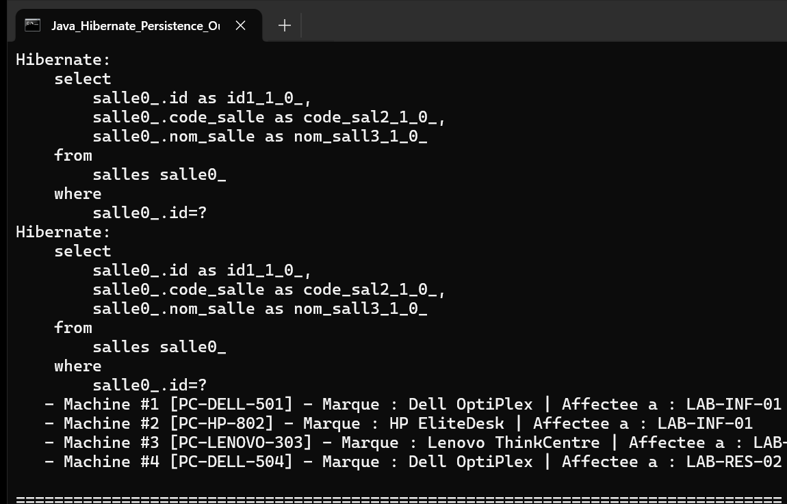

# TP 4 : Hibernate et Persistance des Donnees

Ce projet met en place une couche complete de persistance avec le framework Hibernate ORM 5.6 en Java 17. Il implemente une architecture en couches decouplant les entites du domaine, les DAO generiques, les services metier et la gestion de la SessionFactory.

## Architecture et Composants

- `entities` :
  - `entities.Salle` : Entite representant une salle (`id`, `code`, `libelle`, relation `@OneToMany` vers Machine).
  - `entities.Machine` : Entite representant une machine informatique (`id`, `ref`, `marque`, relation `@ManyToOne` vers Salle).
- `util` :
  - `util.HibernateUtil` : Fabrique de sessions Hibernate (initialisation de la `SessionFactory` a partir de `hibernate.cfg.xml`).
- `dao` :
  - `dao.IDao<T>` : Contrat generique CRUD (`create`, `delete`, `update`, `getById`, `getAll`).
  - `dao.SalleDao` : Implementation Hibernate pour `Salle`.
  - `dao.MachineDao` : Implementation Hibernate pour `Machine` incluant la requete HQL `findByMarque`.
- `services` :
  - `services.SalleService` : Service deleguant les operations a `SalleDao`.
  - `services.MachineService` : Service deleguant les operations a `MachineDao`.
- `test` :
  - `test.Test` : Classe principale validant la persistance, les relations et les requetes HQL.
  - `services.SalleServiceTest` : Test unitaire JUnit validant la creation et la recuperation d'entites.

## Resultat d'Execution

L'application a ete compilee puis executee directement en ligne de commande Java afin de tester le schema relationnel, les requetes HQL et les associations.

La capture d'ecran de la console ci-dessous illustre le resultat reel de l'execution du programme :

### Description de la Capture

La console affiche les etapes d'execution :
1. Initialisation de la SessionFactory Hibernate et creation automatique des tables (`salles` et `machines`).
2. Insertion des entites `Salle` et `Machine` avec leurs cles etrangeres respectives.
3. Execution d'une requete HQL ciblee `from Machine m where m.marque = :marque` retournant les machines correspondantes avec leur salle liee.
4. Affichage detaille de l'ensemble des enregistrements en base de donnees et cloture propre des sessions.
